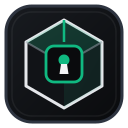

<div align="center">
  
  <h1>Krypton</h1>
  <p><strong>Ferramenta Web para Criptografia e Descriptografia Autenticada de Arquivos em ASP.NET Core MVC (.NET 10)</strong></p>
</div>

---

## Sobre o Projeto

O **Krypton** é uma aplicação web com interface gráfica moderna (**Optical Crystalline Vault**) desenvolvida em **ASP.NET Core MVC (.NET 10)** para proteger e restaurar arquivos sensíveis por meio de criptografia simétrica autenticada (**AES-256-GCM**) e derivação de chave resistente a força bruta (**PBKDF2-HMAC-SHA512**).

O sistema opera sob uma política **Zero-Persistence (Zero Retenção)**: nenhum arquivo enviado, arquivo gerado ou senha é salvo em banco de dados ou disco permanente no servidor, e todas as chaves criptográficas derivadas são limpas imediatamente da memória RAM após a operação (`CryptographicOperations.ZeroMemory`).

---

## Principais Funcionalidades

- **Criptografia de Arquivos (`.krypt`):**
  - Proteção de arquivos de qualquer formato com **AES-256-GCM** em fluxo (*streaming* em blocos de 64 KB).
  - Derivação de chave de 256 bits a partir da senha via **PBKDF2-HMAC-SHA512** (600.000 iterações) com *Salt* criptograficamente aleatório de 256 bits por operação.
  - **Compactação em Fluxo (Opcional):** Reduz o tamanho do arquivo via `GZipStream` antes de aplicar a cifra.
  - **Ocultação de Nome Externo (Opcional):** Gera um nome anônimo para o arquivo baixado (ex.: `vault-a1b2c3d4.krypt`), preservando o nome original protegido dentro dos metadados autenticados.
- **Processamento em Lote (Múltiplos Arquivos):**
  - **Modo Cofre Único (`.krypt`):** Empacota até 50 arquivos simultâneos em um container interno e criptografa tudo em um único arquivo `.krypt`.
  - **Modo Arquivos Separados (`.zip`):** Criptografa cada arquivo individualmente (cada um com seu próprio *Salt* e *Nonce*) e entrega todos agrupados em um pacote `.zip`.
- **Descriptografia e Verificação Anti-Adulteração:**
  - Validação da assinatura binária `KRYPT1`, verificação imediata da senha através do bloco de metadados (`EncryptedMeta`) e validação da Tag GCM de 128 bits em cada bloco de 64 KB.
  - Restauração automática do arquivo original com seu nome e extensão originais.
- **Interface Gráfica Intuitiva:**
  - Landing Page com ilustrações vetoriais atmosféricas, malha óptica interativa em `<canvas>` e portais com efeito *spotlight* reativo ao cursor.
  - Zonas de *Drag-and-Drop*, alternador rápido entre os modos **Criptografar** e **Descriptografar**, histórico efêmero local (`sessionStorage`) e suporte a **Tema Escuro / Claro**.

---

## Especificação do Formato Binário `.krypt` (v1)

Todo arquivo gerado pelo Krypton possui um cabeçalho binário público de **62 bytes** autenticado como **AAD (*Associated Authenticated Data*)** em todos os blocos `AES-256-GCM`:

| Offset | Campo | Tamanho | Descrição |
| :--- | :--- | :--- | :--- |
| `0x00` | `MagicBytes` | 6 bytes | Assinatura ASCII fixa: `KRYPT1` |
| `0x06` | `Version` | 1 byte | Versão do formato (`0x01`) |
| `0x07` | `Flags` | 1 byte | Bitmask (`Bit 0`: Compactado, `Bit 1`: Nome oculto, `Bit 2`: Cofre de lote) |
| `0x08` | `KdfIterations` | 4 bytes (`int32`) | Iterações do `PBKDF2-HMAC-SHA512` (padrão: `600.000`) |
| `0x0C` | `Salt` | 32 bytes | Salt aleatório gerado via CSPRNG (`RandomNumberGenerator`) |
| `0x2C` | `BaseNonce` | 12 bytes | Nonce base de 96 bits (combinado via XOR com o índice de cada bloco) |
| `0x38` | `ChunkSize` | 4 bytes (`int32`) | Tamanho do bloco de dados (padrão: `65536` bytes = 64 KB) |
| `0x3C` | `MetadataLength` | 2 bytes (`uint16`) | Tamanho do bloco `EncryptedMeta` |
| `0x3E` | `EncryptedMeta` | `N` bytes | Metadados originais em JSON criptografados + Tag GCM (16 bytes) |
| `0x3E + N` | `PayloadChunks` | Variável | Sequência de blocos criptografados `[Ciphertext + Tag GCM (16 bytes)]` |

---

## Estrutura do Repositório

```text
Krypton/
├── specs/                                       # Especificações funcionais e técnicas do sistema
│   ├── README.md
│   ├── 00-visao-geral-e-arquitetura.md
│   ├── 01-criptografia-de-arquivos.md
│   ├── 02-descriptografia-de-arquivos.md
│   ├── 03-processamento-em-lote-e-compactacao.md
│   └── 04-interface-grafica-e-experiencia-usuario.md
└── Krypton.Web/                                 # Aplicação Web ASP.NET Core MVC (.NET 10)
    ├── Controllers/                             # HomeController, EncryptionController, DecryptionController
    ├── Infrastructure/                          # CryptoSelfTestRunner (--self-test)
    ├── Models/                                  # Domain (KryptHeader, KryptMetadata), Enums, ViewModels
    ├── Services/                                # CryptoService (AES-256-GCM) e KeyDerivationService (PBKDF2)
    ├── Views/                                   # Razor Views (Home, Encryption, Decryption, Shared)
    ├── wwwroot/                                 # CSS, JS, logo, favicons e imagens de fundo em SVG
    └── Program.cs                               # Ponto de entrada e configuração do pipeline MVC
```

---

## Como Executar o Projeto

### Pré-requisitos
- [.NET 10 SDK](https://dotnet.microsoft.com/) instalado.

### 1. Executar a aplicação web
No terminal, a partir da raiz do repositório:

```bash
dotnet run --project Krypton.Web/Krypton.Web.csproj
```

Em seguida, acesse a URL exibida no console (ex.: `https://localhost:7195` ou `http://localhost:5109`), ou abra a solução `Krypton.Web/Krypton.Web.slnx` diretamente no **Visual Studio**.

### 2. Executar o autodiagnóstico criptográfico (`--self-test`)
Para rodar a bateria integrada de testes do motor `AES-256-GCM` e `PBKDF2-HMAC-SHA512` via linha de comando:

```bash
dotnet run --project Krypton.Web/Krypton.Web.csproj -- --self-test
```

---

## Documentação e Especificações (`specs/`)

- [Índice Geral de Especificações](specs/README.md)
- [00 — Visão Geral e Arquitetura](specs/00-visao-geral-e-arquitetura.md)
- [01 — Criptografia de Arquivos](specs/01-criptografia-de-arquivos.md)
- [02 — Descriptografia de Arquivos](specs/02-descriptografia-de-arquivos.md)
- [03 — Processamento em Lote e Compactação](specs/03-processamento-em-lote-e-compactacao.md)
- [04 — Interface Gráfica (UI/UX)](specs/04-interface-grafica-e-experiencia-usuario.md)
- [05 — Diagramas UML e Modelagem de Software](specs/05-diagramas-uml-e-modelagem.md)

---

## Autoria e Licença

Desenvolvido por **Gabriela Esmaniotto** • 2026.  
Distribuído sob a licença especificada no arquivo [LICENSE](LICENSE).
