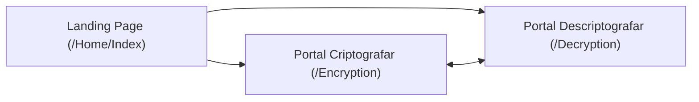

# 04 - Especificação de Interface Gráfica (UI/UX) e Experiência do Usuário

## 1. Direção Visual: "Optical Crystalline Vault"
A interface gráfica do **Krypton** é inspirada na emissão espectral do gás nobre Kriptônio ($Z = 36$) e em câmaras ópticas de refração, combinando fundos atmosféricos ilustrados em SVG, malha interativa em `<canvas>` e iluminação reativa ao cursor.

### Paleta de Cores (Design Tokens)
- `Obsidian Chamber` (`#060913`): Plano de fundo profundo.
- `Chamber Glass` (`#0D1426`): Superfícies translúcidas com `backdrop-filter: blur(12px)`.
- `Krypton Spectral Cyan` (`#22D3EE`): Cor semântica exclusiva para **Criptografar / Selar**.
- `Argon Violet-Indigo` (`#818CF8`): Cor semântica exclusiva para **Descriptografar / Restaurar**.
- `Polar Alabaster` (`#F1F5F9`): Tipografia principal de alto contraste.

---

## 2. Landing Page e Mapa de Navegação

### 2.1 Landing Page (`Home/Index.cshtml`)
1. **Hero Stage com Imagem de Fundo e Canvas Interativo:**
   - Plano de fundo com a arte vetorial `/images/hero-krypton-chamber.svg` sobreposta por uma rede óptica animada em `<canvas id="kryptonHeroCanvas">` (respeitando `prefers-reduced-motion`).
   - Botões de ação primários destacados para **Criptografar arquivos** e **Descriptografar arquivo**, acompanhados de cartões translúcidos resumindo os parâmetros do motor (`AES-256-GCM`, `PBKDF2-SHA512`, `Blocos 64 KB`, `Zero retenção`).
2. **Portais Gêmeos em Destaque (`Criptografar` vs. `Descriptografar`):**
   - Dois grandes cartões interativos lado a lado com imagens de fundo dedicadas (`/images/bg-encrypt-portal.svg` e `/images/bg-decrypt-portal.svg`), ícones vetoriais em SVG e efeito *spotlight* radial que acompanha o movimento do mouse (`--spotlight-x`, `--spotlight-y`).
3. **Fluxo Visual em 3 Etapas e Atividade Recente:**
   - Explicação visual direta do processo em 3 passos numerados e tabela de atividade efêmera da aba atual (`sessionStorage`).

### 2.2 Áreas de Trabalho (`Encryption/Index.cshtml` e `Decryption/Index.cshtml`)
- **Alternador Rápido de Modo (*Workspace Switcher*):** Pílula segmentada no topo permitindo alternar instantaneamente entre **Criptografar** e **Descriptografar** sem precisar voltar ao início.
- **Dropzone Orbital Interativa:** Zona de *Drag-and-Drop* com ícone vetorial animado, contador de tamanho total e remoção individual de arquivos.
- **Indicador de Nível de Senha em Tempo Real:** Barra visual que acompanha a digitação da senha e valida instantaneamente se a confirmação coincide.
