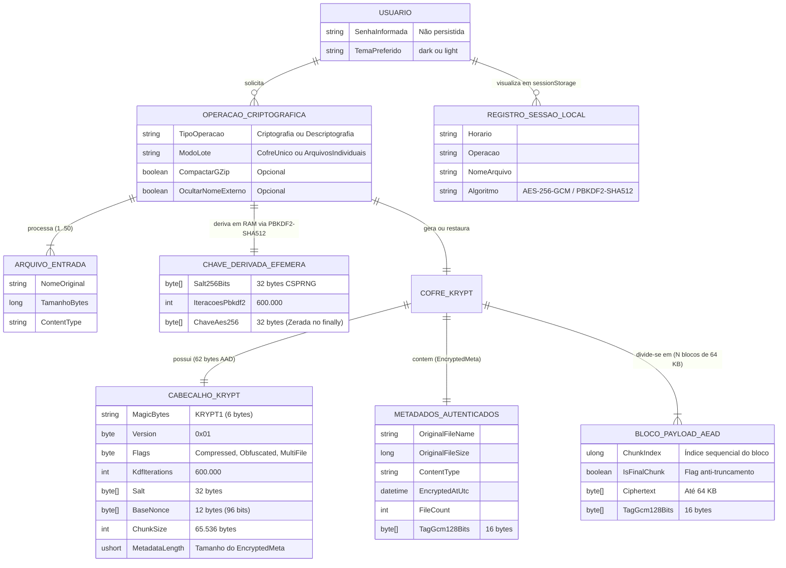
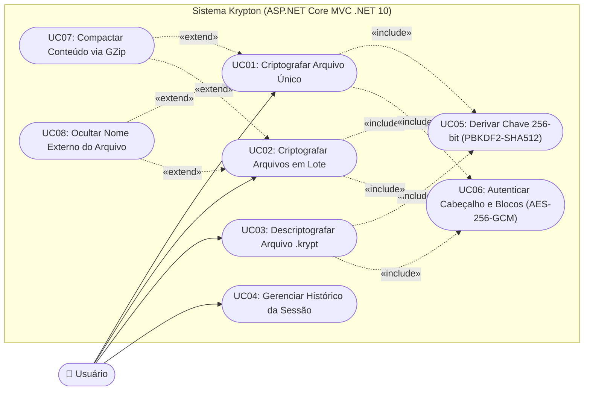
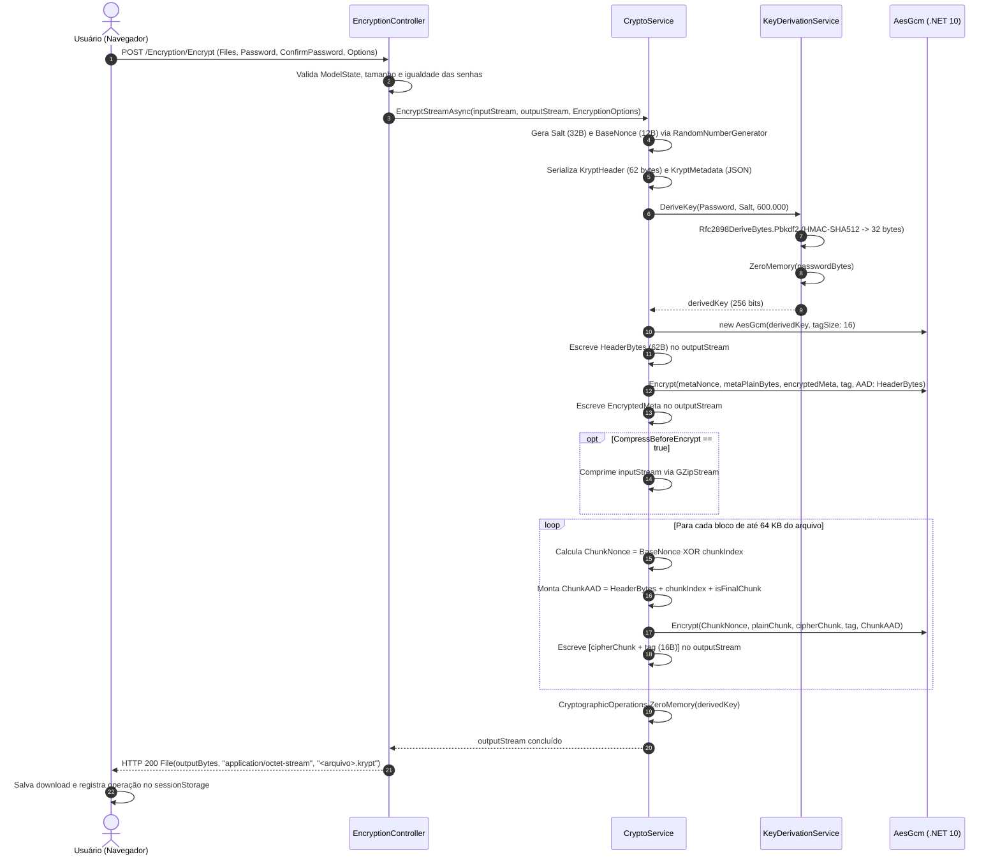
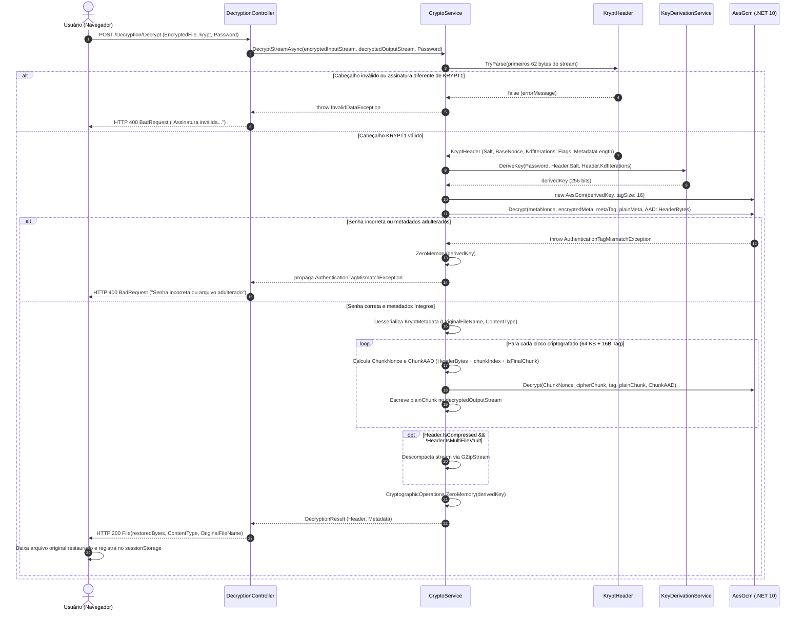

# 05 - Modelagem e Diagramas UML do Sistema (Krypton)

Este documento reúne a modelagem de engenharia de software do sistema **Krypton (ASP.NET Core MVC • .NET 10)**, contemplando:
- **a) Modelo Conceitual**
- **b) Diagrama de Casos de Uso**
- **c) Casos de Uso Textuais (Expandidos)**
- **d) Diagrama de Classes**
- **e) Diagramas de Sequência (Criptografia e Descriptografia)**

---

## a) Modelo Conceitual

O modelo conceitual abaixo representa as entidades do domínio do problema e suas associações durante uma operação no Krypton. Como o sistema adota a política *Zero-Persistence*, todas as instâncias existem exclusivamente em memória/fluxo (*stream*) durante a requisição do usuário.

---

## b) Diagrama de Casos de Uso

O diagrama a seguir ilustra as interações do ator **Usuário** com os casos de uso do sistema **Krypton**, incluindo as relações `<<include>>` (obrigatórias) e `<<extend>>` (opcionais).

---

## c) Casos de Uso Textuais

### UC01 — Criptografar Arquivo Único
| Item | Descrição |
| :--- | :--- |
| **Identificador e Nome** | **UC01 — Criptografar Arquivo Único** |
| **Ator Primário** | Usuário |
| **Resumo** | O usuário seleciona um arquivo no computador, define uma senha e baixa o arquivo criptografado e autenticado no formato `.krypt`. |
| **Pré-condições** | O usuário está na tela de Criptografia (`/Encryption`) e possui um arquivo válido com tamanho de até 500 MB. |
| **Pós-condições** | O usuário recebe o download do arquivo `.krypt`, a chave derivada é zerada da RAM do servidor e a operação é registrada no `sessionStorage` da aba do navegador. |

**Fluxo Principal (Caminho Feliz):**
1. O usuário seleciona ou arrasta um arquivo para a área de entrada (*Dropzone*).
2. O sistema exibe o nome e o tamanho formatado do arquivo na lista de entrada.
3. O usuário digita a **Senha de proteção** (mínimo de 8 caracteres) e a **Confirmação de senha**.
4. O sistema valida em tempo real que a senha atende ao comprimento mínimo e que a confirmação é idêntica.
5. O usuário aciona o botão **"Criptografar e baixar arquivo .krypt"**.
6. O sistema gera um `Salt` aleatório de 32 bytes e um `BaseNonce` aleatório de 12 bytes usando `RandomNumberGenerator`.
7. O sistema deriva a chave de 256 bits (32 bytes) a partir da senha e do `Salt` via `PBKDF2-HMAC-SHA512` com 600.000 iterações (**UC05**).
8. O sistema monta o cabeçalho `KRYPT1` de 62 bytes e criptografa os metadados originais (`OriginalFileName`, `OriginalFileSize`, `ContentType`, `EncryptedAtUtc`) com `AES-256-GCM` usando o cabeçalho como AAD (**UC06**).
9. O sistema lê o arquivo de entrada em blocos de 64 KB, criptografando e autenticando cada bloco com `AES-256-GCM`.
10. O sistema limpa a chave derivada da memória RAM (`CryptographicOperations.ZeroMemory`) e envia o arquivo `<nome>.krypt` para download no navegador do usuário.

**Fluxos Alternativos:**
- **FA01 — Compactar antes de criptografar (`UC07`):** No passo 4, se o usuário ativar a opção *"Compactar antes de criptografar"*, o sistema comprime o stream de entrada via `GZipStream` e ativa a flag `CompressedContainer` no cabeçalho antes de executar o passo 9.
- **FA02 — Ocultar nome externo (`UC08`):** No passo 4, se o usuário ativar a opção *"Ocultar nome externo"*, o arquivo entregue no passo 10 recebe um nome aleatório (`vault-<hex>.krypt`), mantendo o nome verdadeiro apenas dentro do bloco `EncryptedMeta`.

**Fluxos de Exceção:**
- **FE01 — Nenhum arquivo selecionado:** No passo 5, se nenhum arquivo tiver sido selecionado, o sistema exibe o alerta *"Escolha pelo menos um arquivo na área de entrada antes de criptografar"* e interrompe o envio.
- **FE02 — Senha curta ou confirmação divergente:** No passo 5, se a senha tiver menos de 8 caracteres ou divergir da confirmação, o sistema exibe mensagem de erro e aborta a operação.

---

### UC02 — Criptografar Arquivos em Lote
| Item | Descrição |
| :--- | :--- |
| **Identificador e Nome** | **UC02 — Criptografar Arquivos em Lote** |
| **Ator Primário** | Usuário |
| **Resumo** | O usuário seleciona de 2 a 50 arquivos simultaneamente para protegê-los com senha em uma única operação. |
| **Pré-condições** | O usuário está na tela `/Encryption` e seleciona 2 ou mais arquivos (até 50 arquivos / 500 MB no total). |
| **Pós-condições** | O usuário recebe um Cofre Único `.krypt` (contendo o pacote ZIP interno criptografado) ou um pacote `.zip` contendo os arquivos `.krypt` individuais. |

**Fluxo Principal:**
1. O usuário arrasta ou seleciona 2 ou mais arquivos na *Dropzone*.
2. O sistema lista todos os arquivos selecionados e exibe automaticamente o painel **"Como deseja empacotar os múltiplos arquivos?"** com a opção **"Cofre único (`.krypt`)"** pré-selecionada.
3. O usuário informa e confirma a senha de proteção e aciona **"Criptografar e baixar arquivo .krypt"**.
4. O sistema sanitiza os nomes dos arquivos (`Path.GetFileName`), empacota todos em um `ZipArchive` em memória, ativa as flags `CompressedContainer | MultiFileVault` e criptografa o pacote inteiro com `AES-256-GCM` em um único arquivo `Krypton-Vault-<N>files.krypt`.
5. O sistema limpa a chave da memória RAM e inicia o download do cofre único.

**Fluxos Alternativos:**
- **FA01 — Modo Arquivos Separados (`.zip`):** No passo 2, se o usuário selecionar **"Arquivos separados (`.zip`)"**, o sistema criptografa cada arquivo de entrada individualmente (gerando um `Salt` e `BaseNonce` exclusivos para cada arquivo) e agrupa todos os arquivos `.krypt` gerados dentro de um pacote `Krypton-Batch-<N>files.zip`.

**Fluxos de Exceção:**
- **FE01 — Limite de 50 arquivos excedido:** Caso o lote ultrapasse 50 arquivos, o controlador rejeita a requisição com a mensagem *"O limite máximo por lote é de 50 arquivos"*.

---

### UC03 — Descriptografar Arquivo `.krypt`
| Item | Descrição |
| :--- | :--- |
| **Identificador e Nome** | **UC03 — Descriptografar Arquivo `.krypt`** |
| **Ator Primário** | Usuário |
| **Resumo** | O usuário envia um arquivo `.krypt` e informa a senha para validar a integridade/autenticidade `AES-256-GCM` e restaurar o arquivo original. |
| **Pré-condições** | O usuário possui um arquivo `.krypt` gerado pelo sistema e conhece a senha utilizada na criptografia. |
| **Pós-condições** | O arquivo original é reconstruído de forma idêntica ao original e baixado no navegador do usuário. |

**Fluxo Principal:**
1. O usuário acessa `/Decryption` e seleciona ou arrasta um arquivo `.krypt`.
2. O usuário digita a senha do arquivo e clica em **"Descriptografar e restaurar original"**.
3. O sistema lê e valida os 62 bytes do cabeçalho `KRYPT1`.
4. O sistema deriva a chave de 256 bits via `PBKDF2-HMAC-SHA512` usando o `Salt` e o número de iterações lidos do cabeçalho (**UC05**).
5. O sistema descriptografa e valida a Tag GCM do bloco `EncryptedMeta` usando os 62 bytes do cabeçalho como AAD (**UC06**), recuperando o nome original e o tipo MIME.
6. O sistema lê, autentica e descriptografa sequencialmente todos os blocos de 64 KB do payload, verificando o marcador `isFinalChunk` no último bloco.
7. Se a flag `CompressedContainer` estiver ativa (e não for `MultiFileVault`), o sistema descompacta o stream `GZipStream` de forma transparente.
8. O sistema limpa a chave da memória RAM e entrega o arquivo original restaurado para download.

**Fluxos de Exceção:**
- **FE01 — Arquivo não é um `.krypt` válido:** No passo 3, se os primeiros 6 bytes não forem `KRYPT1` ou o cabeçalho estiver truncado, o sistema aborta a operação e retorna *"Assinatura inválida: este arquivo não possui o cabeçalho 'KRYPT1' do sistema Krypton"*.
- **FE02 — Senha incorreta ou arquivo adulterado (`AuthenticationTagMismatchException`):** Nos passos 5 ou 6, se a senha estiver incorreta ou se qualquer byte do cabeçalho, dos metadados ou dos blocos de dados tiver sido modificado/truncado, o `AesGcm` lança `AuthenticationTagMismatchException`. O sistema descarta imediatamente os dados parciais e exibe: *"Falha de Autenticação (AES-256-GCM): Senha incorreta ou o arquivo .krypt sofreu adulteração"*.

---

### UC04 — Gerenciar Histórico Efêmero da Sessão
| Item | Descrição |
| :--- | :--- |
| **Identificador e Nome** | **UC04 — Gerenciar Histórico Efêmero da Sessão** |
| **Ator Primário** | Usuário |
| **Resumo** | O usuário consulta ou limpa a lista de operações realizadas durante a sessão atual na aba do navegador. |
| **Pré-condições** | O usuário acessa a Landing Page (`/`). |
| **Pós-condições** | Os registros locais em `sessionStorage` são exibidos ou removidos conforme a ação do usuário. |

**Fluxo Principal:**
1. O usuário visualiza a tabela **"Atividade recente nesta aba"** na página inicial.
2. O sistema lê os registros salvos localmente em `sessionStorage` e exibe o tipo de operação (*Arquivo selado* ou *Cofre restaurado*), o nome do arquivo, o motor utilizado (`AES-256-GCM / PBKDF2-SHA512`), o status e o horário.
3. O usuário pode remover um item individual clicando no botão `×` da linha correspondente ou remover todos os itens clicando em **"Limpar histórico"**.

---

## d) Diagrama de Classes

O diagrama de classes abaixo reflete fielmente a arquitetura implementada em `Krypton.Web` (.NET 10), organizada nas camadas de **Controllers**, **Services**, **Domain/Enums** e **ViewModels**.

```mermaid
classDiagram
    direction TB

    class HomeController {
        +Index() IActionResult
        +Error() IActionResult
    }

    class EncryptionController {
        -ICryptoService _cryptoService
        +EncryptionController(ICryptoService cryptoService)
        +Index() IActionResult
        +Encrypt(EncryptFileViewModel model, CancellationToken ct) Task~IActionResult~
        -SetKryptonResponseHeaders(string fileName) void
        -GetUniqueSafeFileName(string fileName, HashSet~string~ usedNames)$ string
    }

    class DecryptionController {
        -ICryptoService _cryptoService
        +DecryptionController(ICryptoService cryptoService)
        +Index() IActionResult
        +Decrypt(DecryptFileViewModel model, CancellationToken ct) Task~IActionResult~
    }

    class ICryptoService {
        <<interface>>
        +EncryptStreamAsync(Stream input, Stream output, EncryptionOptions options, CancellationToken ct) Task
        +DecryptStreamAsync(Stream encryptedInput, Stream decryptedOutput, string password, CancellationToken ct) Task~DecryptionResult~
    }

    class CryptoService {
        -IKeyDerivationService _keyDerivationService
        +CryptoService(IKeyDerivationService keyDerivationService)
        +EncryptStreamAsync(Stream input, Stream output, EncryptionOptions options, CancellationToken ct) Task
        +DecryptStreamAsync(Stream encryptedInput, Stream decryptedOutput, string password, CancellationToken ct) Task~DecryptionResult~
        -ReadAndDecryptMetadataAsync(AesGcm aesGcm, Stream input, KryptHeader header, byte[] headerBytes, CancellationToken ct)$ Task~KryptMetadata~
        -EncryptPayloadChunksAsync(AesGcm aesGcm, Stream input, Stream output, byte[] baseNonce, byte[] headerBytes, int chunkSize, CancellationToken ct)$ Task
        -DecryptPayloadChunksAsync(AesGcm aesGcm, Stream input, Stream output, KryptHeader header, byte[] headerBytes, CancellationToken ct)$ Task
        -DeriveBlockNonce(ReadOnlySpan~byte~ baseNonce, ulong blockCounter, Span~byte~ destinationNonce)$ void
    }

    class IKeyDerivationService {
        <<interface>>
        +DeriveKey(string password, ReadOnlySpan~byte~ salt, int iterations) byte[]
    }

    class KeyDerivationService {
        -int DerivedKeySizeBytes = 32
        +DeriveKey(string password, ReadOnlySpan~byte~ salt, int iterations) byte[]
    }

    class EncryptionOptions {
        +string Password
        +int Pbkdf2Iterations
        +int ChunkSize
        +bool Compress
        +bool IsMultiFileVault
        +bool ObfuscateFileName
        +KryptMetadata Metadata
    }

    class DecryptionResult {
        +KryptHeader Header
        +KryptMetadata Metadata
    }

    class KryptHeader {
        +int HeaderSizeBytes = 62$
        +int SaltSizeBytes = 32$
        +int NonceSizeBytes = 12$
        +int TagSizeBytes = 16$
        +byte Version
        +KryptHeaderFlags Flags
        +int KdfIterations
        +byte[] Salt
        +byte[] BaseNonce
        +int ChunkSize
        +ushort MetadataLength
        +bool IsCompressed
        +bool IsMultiFileVault
        +bool IsObfuscatedName
        +ToByteArray() byte[]
        +WriteTo(Span~byte~ destination) void
        +TryParse(ReadOnlySpan~byte~ source, out KryptHeader header, out string errorMessage)$ bool
    }

    class KryptMetadata {
        +string OriginalFileName
        +long OriginalFileSize
        +string ContentType
        +DateTime EncryptedAtUtc
        +int FileCount
    }

    class KryptHeaderFlags {
        <<enumeration>>
        None = 0
        CompressedContainer = 1
        ObfuscatedFileName = 2
        MultiFileVault = 4
    }

    class BatchEncryptionMode {
        <<enumeration>>
        SingleEncryptedVault = 1
        IndividualKryptFiles = 2
    }

    class EncryptFileViewModel {
        +List~IFormFile~ Files
        +string Password
        +string ConfirmPassword
        +bool CompressBeforeEncrypt
        +bool ObfuscateOutputFileName
        +BatchEncryptionMode BatchMode
    }

    class DecryptFileViewModel {
        +IFormFile EncryptedFile
        +string Password
    }

    EncryptionController --> ICryptoService : "usa"
    EncryptionController ..> EncryptFileViewModel : "recebe"
    DecryptionController --> ICryptoService : "usa"
    DecryptionController ..> DecryptFileViewModel : "recebe"

    CryptoService ..|> ICryptoService : "implementa"
    KeyDerivationService ..|> IKeyDerivationService : "implementa"
    CryptoService --> IKeyDerivationService : "usa"
    CryptoService ..> EncryptionOptions : "consome"
    CryptoService ..> DecryptionResult : "retorna"

    EncryptionOptions *-- KryptMetadata : "contém"
    DecryptionResult *-- KryptHeader : "contém"
    DecryptionResult *-- KryptMetadata : "contém"
    KryptHeader --> KryptHeaderFlags : "usa"
    EncryptFileViewModel --> BatchEncryptionMode : "usa"
```

---

## e) Diagramas de Sequência

### e.1) Diagrama de Sequência — Criptografia de Arquivo (`POST /Encryption/Encrypt`)

---

### e.2) Diagrama de Sequência — Descriptografia de Arquivo (`POST /Decryption/Decrypt`)

